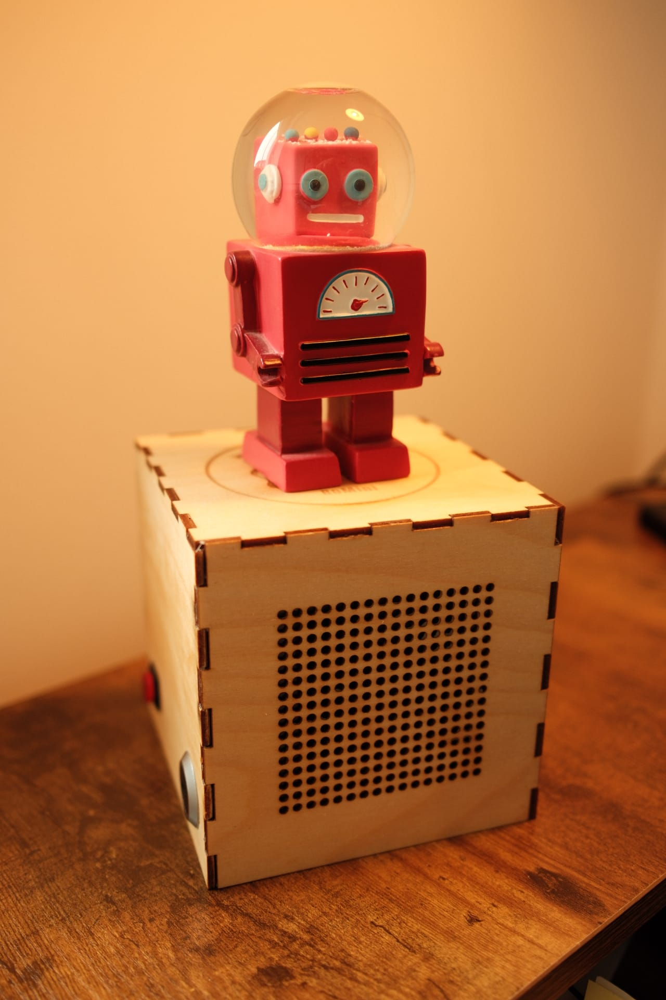
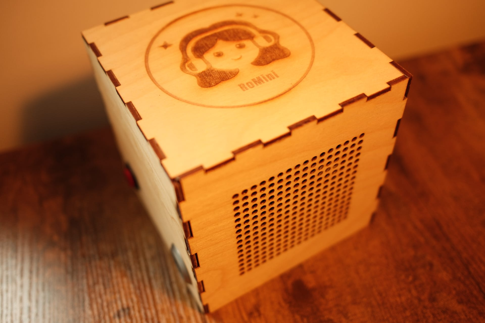
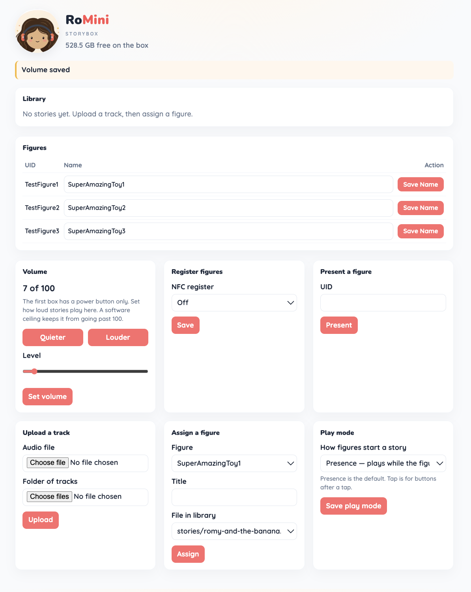
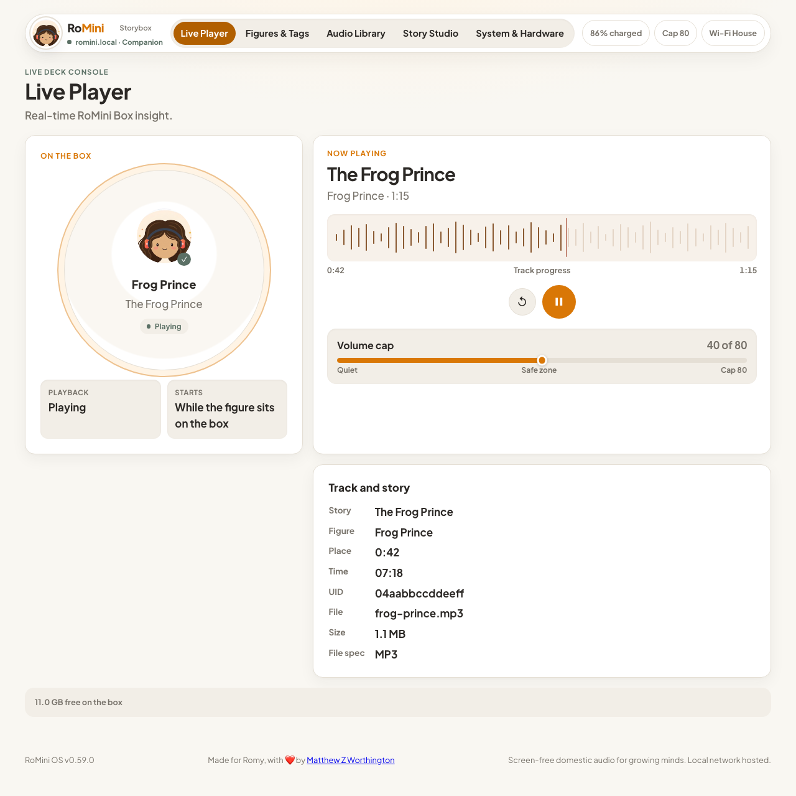

<p align="center">
  
</p>

# RoMini

[](https://github.com/mzworthington/RoMini/actions/workflows/ci.yml)
[](https://sonarcloud.io/summary/new_code?id=mzworthington_RoMini)

Screen-free NFC audio player for a Raspberry Pi. Figures start Tracks; the parent maps Tags on the house LAN.

The built box is a 130 mm birch cube. A figure sits on the engraved lid. The speaker grille is the front. The red button and USB-C are on the side.

<p align="center">
  
</p>

<p align="center">
  
</p>

## Set up the Pi

Use a **Raspberry Pi 4** with Lite OS, house Wi-Fi and SSH. The player is a GitHub Release **wheel** (`bin/install-pi`). There is no repo on the box. HAT jumpers, buttons, overlay and library disk: [docs/hardware.md](docs/hardware.md) and [docs/guide.md](docs/guide.md) §3.

1. **Flash.** Raspberry Pi Imager → **Lite 64-bit**. Enable SSH (key), house Wi-Fi (country GB), hostname `romini` and user `pi`. Do not expand the card to fill the disk if you will add a `romini-data` partition later. Use a **≥3A** USB-C PSU (or the UPS HAT USB-C on battery).
2. **Boot and SSH.** Wait until the ACT LED settles. From a laptop on the same Wi-Fi:

   ```bash
   ssh pi@romini.local
   ```

   If `.local` fails, find the lease in the Google Wifi / router client list and SSH to that IPv4.
3. **Install the player** (one command, on the Pi):

   ```bash
   curl -fsSL https://raw.githubusercontent.com/mzworthington/RoMini/main/bin/install-pi | bash
   ```

   That `apt`s Python/mpv/Avahi, installs the latest `romini-*.whl` into `/var/lib/romini/install/venv`, turns on SPI and I2C, writes systemd + Avahi, and enables `romini-core` plus `romini-update.timer`.
4. **Open the dashboard.** On the house LAN: [http://romini.local](http://romini.local). Upload MP3s and map Tags there. Settings shows what the box has done. Tracks live in `/var/lib/romini/library`, not in the wheel.

## Update the player

The box installs the latest **GitHub Release** wheel into `/var/lib/romini/install/venv`. The timer runs 5 minutes after boot and at **03:15**. Laptop commits are not on the box until that Release exists. Do not `git pull` — there is no repo on the Pi.

Force it now (SSH, nothing playing).

```bash
sudo systemctl start romini-update.service
sudo journalctl -u romini-update.service -n 50 --no-pager
/var/lib/romini/install/venv/bin/pip show romini
```

Same updater: `sudo /var/lib/romini/install/venv/bin/python -m romini.composition.update`. It **skips while** a Track is playing (mpv `pause == false`). Lift the figure first.

Optional PAT if GitHub rate-limits you: `GITHUB_TOKEN` and `GITHUB_REPO` in `/etc/romini/env` (`chmod 600`).

## Laptop (`sim`)

```bash
./bin/bootstrap
make test
./bin/sim
```

Dashboard on the laptop is `http://127.0.0.1:8080`. Same domain as the box; NFC/GPIO/player are fakes.

## Public site

The demo hostname, D1 database, and R2 bucket live in `infra/cloudflare` (Pulumi stack `prod`). The database `5948544a-74ae-4e4e-922c-908af99e4b9a` and bucket `romini-demo` already exist and are imported there. Wrangler still uploads the Worker script from `deploy/demo` and applies `migrations/0001_state.sql`.

```bash
cd infra/cloudflare && pulumi up
cd ../../deploy/demo && npx wrangler deploy
```

```bash
python -m romini.adapters.cloudflare.seed path/to/catalog.yaml > seed.sql
npx wrangler d1 execute romini-demo --remote --file=seed.sql
```

`romini.party` and `www.romini.party` are one page: a circular picture of RoMini, **find out more** linking to [Building a story box for Romy](https://mzworthington.co.uk/open-source/building-a-story-box-for-romy), and **demo dashboard** linking to `demo.romini.party`.

The zone is `romini.party` in [edge-dns](https://github.com/mzworthington/edge-dns). After that zone is active, `cd deploy/party && npx wrangler deploy` (`CLOUDFLARE_API_TOKEN` set) attaches the hostnames and publishes the page.

## Parent dashboard

On the box, Avahi is `http://<hostname>.local` (usually [http://romini.local](http://romini.local)).

<!-- <p align="center">
  
</p> -->




Tab-by-tab screens: [docs/dashboard.md](docs/dashboard.md).

| Doc | Role |
|-----|------|
| [docs/guide.md](docs/guide.md) | Full laptop + Pi walkthrough |
| [docs/dashboard.md](docs/dashboard.md) | Parent UI screenshots |
| [docs/hardware.md](docs/hardware.md) | BOM, PN532 SPI, UPS, GPIO |
| [docs/fabrication.md](docs/fabrication.md) | 3 mm birch cube, laser-cut by [Cutting Edge CNC](https://cuttingedgecnc.co.uk/) |
| [docs/pi-setup.md](docs/pi-setup.md) | Headless flash checklist |
| [docs/PRD_001.md](docs/PRD_001.md) | Product requirements |
| [docs/spec.md](docs/spec.md) | Gherkin, glossary |
| [docs/architecture.md](docs/architecture.md) | Hexagon, OTA, overlay |
| [docs/ADRs/README.md](docs/ADRs/README.md) | Hard-to-reverse choices |
